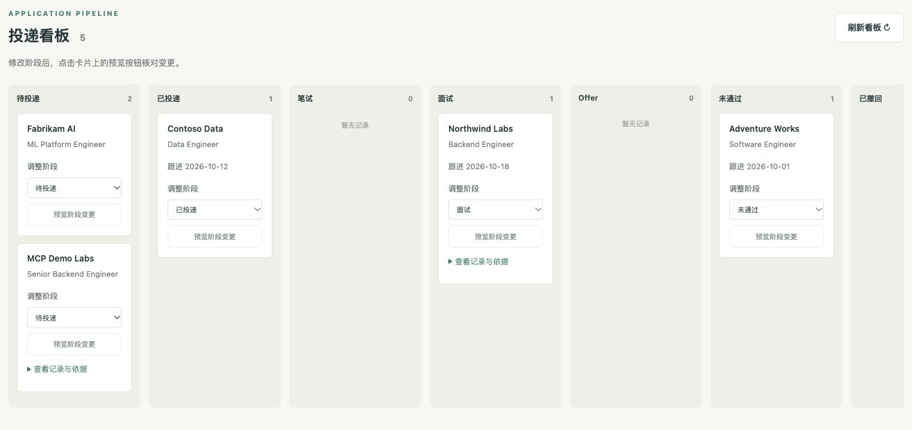

# 本地 Agent 工作台

要求：Node 24+、pnpm。所有页面和写入都运行在本机，默认绑定 `127.0.0.1:3210`。

```bash
pnpm install --frozen-lockfile
pnpm app
```

打开终端打印的地址。默认 `APP_MODE=extractive`：无需 API key，通过真实 MCP 工具检索并展示资料原文摘录，不冒充模型改写。

实时模型模式使用现有 `.env` 的 `LLM_PROVIDER` / `LLM_MODEL` / API key：

```bash
APP_MODE=live pnpm app
```

实时模式先检索，再请求结构化改写；确定性校验处理数字等事实，其他表达交给语义校验；不通过时最多修复一次，仍不支持的陈述不展示。语义校验是概率判断，最终仍需核对原文。当前需求匹配标签是检索信号，尚未计算实际工作年限。

## 操作与验收

1. 点击“载入示例 JD”，再点击“开始分析”。报告展示要求、证据、经历表达、缺失项。
2. 展开“查看依据”核查原文。修改 JD 会使旧报告失去添加资格，需要重新分析。
3. 填公司、职位、阶段和可选跟进日期，点击“预览添加”。弹窗展示完整保存内容。此时看板不变。
4. 点击“取消此次操作”：不写入，也不能复用该操作批准。
5. 重新预览并点击“确认并保存”：看板增加卡片；重复提交相同操作不会重复新增。
6. 在卡片选择新阶段，点击“预览阶段变更”。确认后才更新；如果记录已被其他进程修改，返回版本冲突，需重新预览。
7. 刷新页面或重启服务：看板数据保留。任务报告/页面会话不持久化，重启后未完成的页面确认需重新预览；已经提交的操作结果在 SQLite 中保留。

默认示例 JSON 首次导入到旁边的 `.json.sqlite`，后续数据库是唯一写入目标。原 JSON 不修改。参见 [STORAGE.md](STORAGE.md)。

```bash
# 使用自有资料（目录和数据库均应保持 git-ignored）
PROFILE_DIR=data/profile APPLICATIONS_FILE=data/applications.json APP_MODE=live pnpm app
# 换端口
PORT=3211 pnpm app
# 定位失败步骤（应用默认写脱敏日志）
pnpm trace .traces/app
```

## 运行边界

这是本机单用户应用，使用同源校验和页面会话 token，不提供远程多用户登录。不要把它直接当公网服务部署。
页面取消分析会传播取消信号；远端调用可能已经结束，写入依靠操作幂等保证恢复安全。
报告保存 30 分钟，最多 100 个；页面操作缓存有界。若请求超时但写入结果不确定，可以重试同一操作，并刷新看板核实。

`pnpm build` 编译代码并复制页面和示例 JD。也可从仓库根目录运行 `node dist/src/app/index.js`。
`pnpm test` 的 HTTP 集成测试在临时本地端口和隔离数据上运行；实时生成路径使用脚本模型测试，不作为真实模型效果分数。

验收截图（隔离的合成资料，看板从 4 条变为 5 条）：


